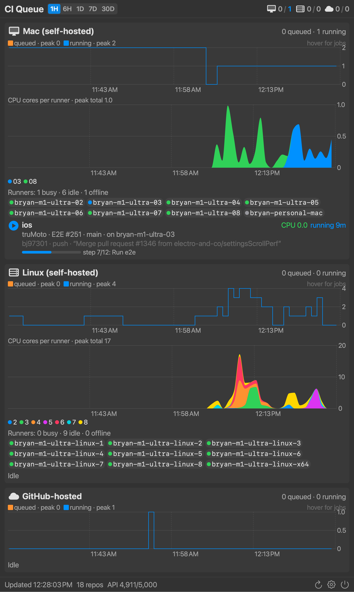
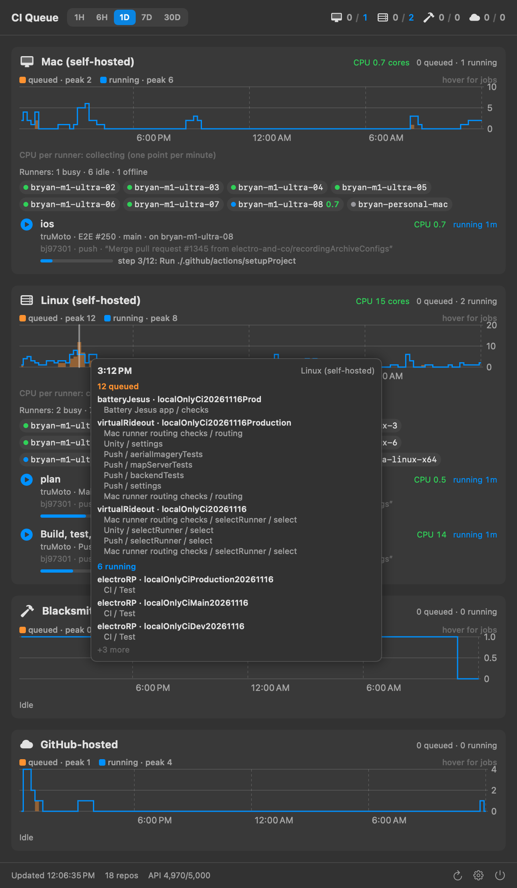

# CIQueueBar

A macOS menu bar app that shows your GitHub Actions job queue, grouped by where the jobs run:

- **Mac**: self-hosted macOS runners
- **Linux**: self-hosted Linux runners
- **Blacksmith**: `blacksmith-*` runners
- **GitHub**: GitHub-hosted `ubuntu-*`, `windows-*`, `macos-*`
- **Other**: anything else

Jobs are matched to your registered self-hosted runners by label, so custom labels like `electro-local-mac` land in the right group.



The menu bar shows a live bar graph of CI CPU for the last 5 minutes (Linux runners green, Mac runners blue, full height = all of this Mac's cores), the CI CPU as a percentage of this Mac, and queue counts like `Mac 3⏳1▶  BS 2▶` (queued ⏳, running ▶). Esc or a click anywhere else closes the panel. Click it for a panel (two columns when the screen is wide enough; it grows to fit the screen and closes when you click anywhere else) with:

- every queued and running job: repo, workflow and run number, branch, who triggered it, commit title, wait or run time, current step, and **CPU cores the job is using**
- your self-hosted runners and whether each is busy, idle or offline, with live CPU
- **history per runner type**: queued and running jobs over 1H / 6H / 1D / 7D / 30D, plus a stacked chart of **CPU per runner**
- a **CPU** section at the top: running jobs ranked by CPU right now (project · branch · workflow / job · runner), a stacked chart of CPU by repo, branch, workflow or job, and the top ones for the period in core-hours
- **which T3 Code thread started it**: each job shows a purple "T3: thread title" line; click it to open that thread in T3 Code. Matching uses T3's local database (`~/.t3/userdata/statev2.sqlite`, read-only): first the run's pull request (or the PR in a "Merge pull request #N" push), then the branch a thread worked on. `CIQueueBar --match owner/repo branch [pr]` shows what a run would match.
- **every chart has a hover card**: the queue chart lists queued and running jobs; CPU charts list each runner or group with its cores and the job it was running
- hover the queue chart to see which project, branch and workflow / job were queued and running at that moment



Click a job to open it on GitHub. History lives in `~/Library/Application Support/CIQueueBar/history.jsonl` (30 days). On first launch the last 24 hours of queue history is rebuilt from GitHub job timestamps; CPU history starts when the app does.

### CPU per job

- **Local runners** (on the Mac running the app): CPU of each `Runner.Worker` process and everything under it, plus detached processes whose path is inside a `.../slots/<runner>/` folder. The runner name comes from the runner's `.runner` file.
- **Runners in a Linux VM or another host**: add the host to `sshCpuHosts`. The app runs `systemctl show 'actions.runner.*'` over ssh every 10 seconds and turns each service's CPUUsageNSec into cores. Jobs in Docker containers aren't counted (they run in the Docker daemon's cgroup).

`CIQueueBar --snapshot out.png [--period 1D] [--group Repo|Branch|Workflow|Job] [--hover queue-linux|cpu-linux|cpu-group <unix time>]` renders that panel with live data to a PNG.

## Install

```sh
./build-app.sh
cp -R build/CIQueueBar.app /Applications/
open -g /Applications/CIQueueBar.app
```

Auth comes from `gh auth token` (or a `GITHUB_TOKEN` env var).

## Config

Optional `~/.config/ciqueuebar/config.json`:

```json
{
  "repos": ["owner/repo", "org/other"],
  "recentDays": 2,
  "maxRepos": 25,
  "refreshSeconds": 60,
  "backfillHours": 24,
  "textScale": 1.5,
  "columns": 2,
  "sshCpuHosts": [["-F", "~/.ssh/myvm.config", "my-linux-vm"]]
}
```

Without `repos`, it scans your repos (owned, collaborator, org member) pushed within `recentDays`.

## Bartender

Bartender files new menu bar items under **Always Hide**. Move CIQueueBar to **Shown** in Bartender's Menu Bar Layout, or drag it out of the hidden section.
